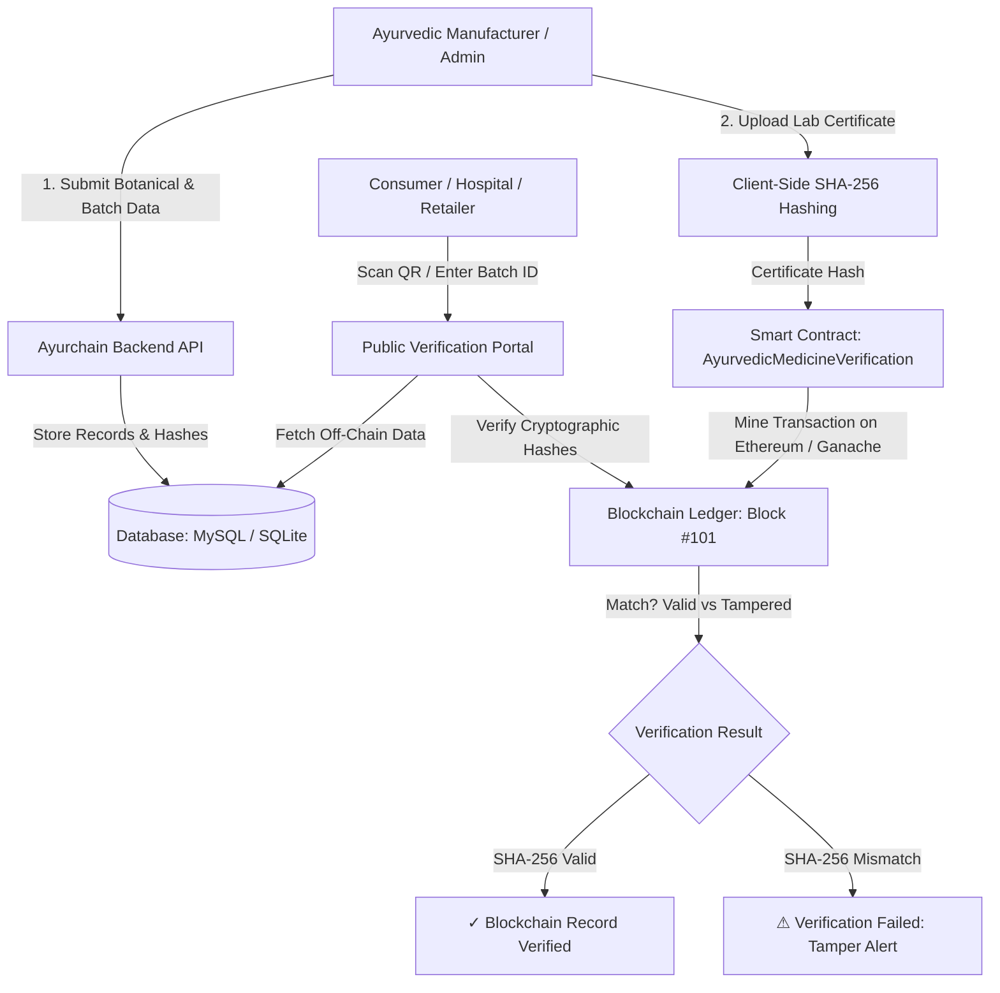

# AYURCHAIN 🌿

### Blockchain-Based Ayurvedic Medicine Storage, Verification & Provenance System

[](https://ayurchain-ten.vercel.app)
[](blockchain/contract/AyurvedicMedicineVerification.sol)
[](api/index.php)
[](https://trufflesuite.com/ganache/)
[](blockchain/js/web3-contract.js)

**Live Demo URL:**
[https://ayurchain-ten.vercel.app](https://ayurchain-ten.vercel.app)\
**Smart Contract:** `AyurvedicMedicineVerification.sol`\
**Network Compatibility:** Ethereum Local Testnet (Ganache), Sepolia, Injected
Provider (MetaMask)

---

## 📖 Overview

**AYURCHAIN** provides an end-to-end provenance and anti-counterfeiting solution
for the Ayurvedic herbal pharmaceutical industry. Traditional herbal
formulations frequently face challenges regarding counterfeit batches,
adulterated botanical ingredients, and falsified quality lab certificates.

AYURCHAIN addresses these challenges using a **hybrid Web2 + Web3
architecture**:

1. **Off-Chain Relational Storage (MySQL / SQLite)**: Stores detailed botanical
   characteristics, sourcing origins, manufacturing batch parameters, active
   herbs, and document metadata.
2. **On-Chain Cryptographic Immutability (Solidity Smart Contract)**: Anchors
   digital signatures, combined batch hashes, and SHA-256 certificate hashes on
   the blockchain ledger.
3. **Public Zero-Gas Verification**: Enables consumers, distributors, and
   regulators to verify authenticity and inspect lifecycle history in real time.

---

## ⚡ Key Architecture & Features

### 1. Dual-Engine Database Architecture

- **Production MySQL**: Connects to MySQL/MariaDB for full relational
  capabilities using prepared PDO statements.
- **Serverless SQLite Fallback**: Auto-seeds database schema and sample records
  when deployed in cloud environments or on Vercel Functions.

### 2. Client-Side Cryptographic Hashing

- Files uploaded by manufacturers (e.g. NABL purity certificates) are hashed in
  the browser via the Web Crypto API (`crypto.subtle.digest("SHA-256")`).
- The digital fingerprint is anchored to the smart contract, preventing
  post-upload certificate substitution.

### 3. Supply Chain Provenance Tracking

Tracks five standardized lifecycle milestones:
$$\text{Manufactured} \longrightarrow \text{Dispatched} \longrightarrow \text{Received} \longrightarrow \text{Distributed} \longrightarrow \text{Sold}$$

Each milestone records block numbers, transaction hashes, locations, and
timestamps.

### 4. Interactive QR Verification

Each registered medicine features dynamic QR code generation containing the
public verification URL. Mobile devices can scan and verify the physical bottle
directly.

### 5. Tamper Detection Demo Mode

The public portal includes simulated tampering tests demonstrating how altering
off-chain expiry dates or certificates triggers cryptographic hash mismatches
against Block #101.

---

## 🏛️ System Architecture



---

## 📂 Project Directory Structure

```text
Ayurchain/
├── api/
│   └── index.php                     # Vercel serverless router and front controller
├── app/
│   ├── admin/                        # Administrative management views
│   │   ├── add_medicine.php          # Register new Ayurvedic medicine & certificates
│   │   ├── change_password.php       # Admin security credentials
│   │   ├── dashboard.php             # Analytics metrics & Chart.js category stats
│   │   ├── delete_medicine.php       # Medicine record cleanup
│   │   ├── edit_medicine.php         # Edit botanical attributes
│   │   ├── history.php               # Supply chain provenance tracking
│   │   ├── medicines.php             # Full directory with pagination & search
│   │   ├── profile.php               # Admin profile settings
│   │   └── view_medicine.php         # Admin view router
│   ├── api/                          # Internal JSON endpoints
│   │   ├── add_history_record.php    # Append lifecycle tracking milestone
│   │   └── save_blockchain_record.php# Store mined blockchain receipt
│   ├── auth/                         # Authentication modules
│   │   ├── login.php                 # Admin login with CSRF validation
│   │   └── logout.php                # Session destruction
│   ├── config/
│   │   └── database.php              # Universal MySQL + SQLite PDO connection
│   ├── includes/                     # Reusable layouts & security helpers
│   │   ├── auth.php                  # Session guard and CSRF helper
│   │   ├── footer.php                # Global footer with Web3 & QR scripts
│   │   ├── functions.php             # Output sanitization & helpers
│   │   └── header.php                # Global navigation & theme assets
│   └── public/                       # Public customer-facing views
│       ├── about.php                 # Project background & specifications
│       ├── index.php                 # Landing page with instant lookup
│       ├── verify.php                # Public verification portal & tamper detector
│       └── view_medicine.php         # Medicine details & QR code generator
├── assets/
│   ├── css/
│   │   └── style.css                 # Custom theme & responsive UI styling
│   └── js/
│       └── script.js                 # Client-side validation & hashing
├── blockchain/
│   ├── contract/
│   │   └── AyurvedicMedicineVerification.sol # Solidity smart contract
│   └── js/
│       ├── contract-config.js        # Deployed contract address & ABI
│       └── web3-contract.js          # Ethers.js + MetaMask bridge
├── database/
│   ├── database.sql                  # MySQL schema definition
│   └── sample-data.sql               # Seed medicines & blockchain records
├── storage/                          # Stored certificates & test files
├── tests/
│   └── test_runner.php               # Automated 10-step end-to-end test suite
└── vercel.json                       # Vercel serverless function & routing configuration
```

---

## 🚀 Deployment & Local Setup

### Option 1: Live Cloud Deployment (Vercel)

The project is configured for one-click deployment on Vercel:

```bash
npx vercel deploy --prod
```

The serverless router (`api/index.php`) and universal PDO database handler
auto-configure SQLite and static asset routes automatically.

### Option 2: Local XAMPP / Apache

1. Move the repository folder into your server root:
   - Windows: `C:\xampp\htdocs\ayurvedic-blockchain`
   - macOS / Linux: `/var/www/html/ayurvedic-blockchain`
2. Start Apache and MySQL services.
3. Create database `ayurvedic_blockchain` in phpMyAdmin and import:
   - `database/database.sql`
   - `database/sample-data.sql`
4. Access the web portal at `http://localhost/ayurvedic-blockchain/`.

### Default Credentials

- **Username / Email:** `admin` or `admin@ayurchain.org`
- **Password:** `admin123`

---

## 🧪 Automated Testing

Run the included verification suite directly via browser or CLI:

```bash
# Via Web Browser / Vercel:
https://ayurchain-ten.vercel.app/test_runner.php

# Via Command Line (with PHP CLI):
php tests/test_runner.php
```

All 10 core verification tests validate database connectivity, bcrypt
authentication, cryptographic SHA-256 record hashes, tamper rejection, and
supply chain integrity.

---

## 📜 Authors & Acknowledgments

- **Aryan Yadav** – Architecture, Smart Contract & Web3 Integration
- **AyurChain Project Team** – Research, Botanical Standardization &
  Documentation
